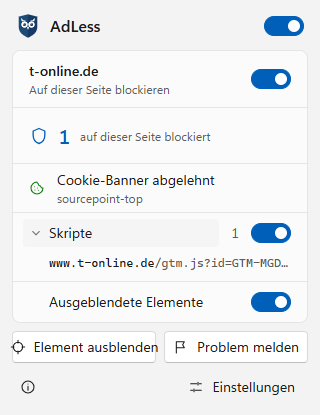

# AdLess

**English** | [Deutsch](README.de.md)

A lean, modern ad blocker for Chrome and Edge. Blocks ads, trackers and annoyances, **rejects cookie banners** and shows you exactly what it blocked – with your own filter lists and rules.



- Blocks ads, trackers, malware sites and annoyances with the well-known filter lists (EasyList, EasyPrivacy, uBlock filters, Peter Lowe, AdGuard and many regional lists)
- **Rejects cookie banners** on its own, or hides them where there is no reject button
- **AdLess filters**: own fixes for sites in Germany, Austria and Switzerland, built from user reports and updated twice a day – no new extension version needed
- The popup shows what was blocked on the page – scripts, images, embedded pages, audio and video, background requests, styles and fonts – and **lists the blocked addresses** of each kind
- Allow a kind of content per site with one switch, or turn AdLess off for a site
- **Hide element**: click anything on a page to hide it for good
- **Report problem**: ads still visible or a page broken? One click opens a prefilled report
- Custom lists, your own rules in uBlock Origin syntax, an allowlist, settings export and import
- Light and dark theme following the browser, English and German
- No account, no telemetry, no "acceptable ads" – AdLess only downloads filter lists

## Installation

**[Get AdLess from the Chrome Web Store](https://chromewebstore.google.com/detail/adless/mfddbnkcgfcpnchpekbgolnbjckbhmmm)** – it works in Chrome and also in Edge (allow extensions from other stores when Edge asks). The Edge Add-ons listing is on its way, and a version for **Firefox** will follow. You can also build it from source (below) and load it as an unpacked extension.

## Using it

Click the AdLess icon in the toolbar:

- **Block on this site** switches AdLess off and on for the current site
- The counter shows how many requests were *blocked on this page*; below, each kind of content has its own count and switch. The arrow next to a kind opens the list of blocked addresses
- *Hidden elements* is element hiding: ad spaces and banners that are made invisible on the page
- When a cookie banner was answered, the popup says so (*Cookie banner rejected*) and names its provider
- **Hide element** starts the element picker, **Report problem** opens a report on GitHub with the page and your settings (the address without its query part)

The settings (*Settings* in the popup):

- **Filter lists** – the bundled lists by topic and language, *AdLess filters* on top; *Update* reloads your own lists and looks for a new AdLess version
- **Custom lists** – add any filter list by its address (uBlock Origin, Adblock Plus and AdGuard syntax)
- **My rules** – your own filters, and the elements you hid with the picker
- **Allowlist** – sites where AdLess does not block
- **General** – *Block ads and trackers*, *Reject cookie banners*, export and import of all settings

Cosmetic filters and scriptlets from your own rules and lists need the browser's user scripts permission: open `chrome://extensions`, choose *Details* for AdLess and turn on *Allow user scripts*. The bundled lists and the AdLess filters work without it.

## Reporting a problem

Ads that get through, a page that breaks, a cookie banner that stays: use *Report problem* in the popup, or [open an issue](https://github.com/naderi/adless/issues/new?template=site-problem.yml). Fixes go into the [AdLess filters](public/filters/adless.txt), which every installed AdLess picks up within half a day.

## Building from source

Needs Node.js 22+, pnpm, Git, curl and bash (Git Bash on Windows).

```
git clone --recurse-submodules https://github.com/naderi/adless.git
cd adless
pnpm install
pnpm engine   # builds the filtering engine with the latest filter lists into engine/
pnpm build    # the extension in dist/chrome-mv3
```

Load `dist/chrome-mv3` in `chrome://extensions` (developer mode → *Load unpacked*).

## How it works

AdLess uses the filtering engine of [uBlock Origin Lite](https://github.com/uBlockOrigin/uBOL-home) (Manifest V3, `declarativeNetRequest`), with its own popup, settings and features on top. Cookie banners are handled with [autoconsent](https://github.com/duckduckgo/autoconsent) by DuckDuckGo. The AdLess filters are compiled by AdLess itself into browser rules and CSS.

## License

[GPL-3.0](LICENSE). The filtering engine contains code from uBlock Origin Lite (© Raymond Hill, GPL-3.0), autoconsent is licensed under MPL-2.0, the filter lists under their authors' licenses. The name and logo "AdLess" are not covered by the license.

## Support

If AdLess saves you time, you can support its development on Ko‑fi. ☕

<a href='https://ko-fi.com/N7N123QIX0' target='_blank'></a>

---

© 2026 [Ali Naderi](https://github.com/naderi) · [digitalent.dev](https://digitalent.dev/en/)
